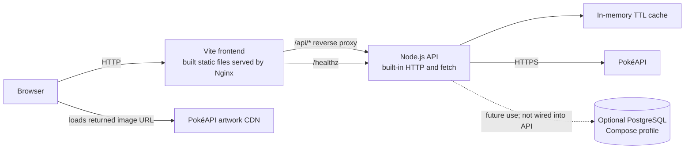
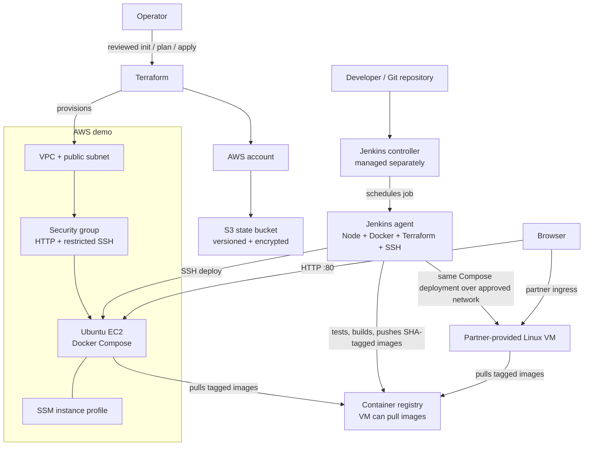

# Pokémon VM Demo

This demo pairs a Vite frontend with a Node.js API. Both services are packaged
as containers and run with Docker Compose on either an AWS EC2 instance created
by Terraform or a Linux VM provided by a partner.

## Application architecture



The UI searches by Pokémon name or Pokédex number and displays artwork, types,
base experience, stats, and an English description. The API normalizes PokéAPI
responses, limits upstream request time, rejects unsafe species URLs, and keeps
successful lookups in a bounded in-memory cache for 10 minutes. No DB is needed
for the current application. PostgreSQL is optional for future experimentation
and is not connected to the API.

## Infrastructure and delivery



Terraform owns the AWS host and its network; Jenkins delivers application
images. Jenkins and its controller/agent are prerequisites and are not created
by the Terraform configuration in this repository. For a partner-managed VM,
skip the AWS provisioning step and configure a Jenkins agent with an approved
network path to that VM.

## Repository layout

```text
app/
  backend/       Node.js API and built-in test suite
  frontend/      Vite application, source CSS/JS, and Nginx config
compose.yaml     Runtime services shared by local and VM deployments
compose.build.yaml
Jenkinsfile
terraform/       AWS EC2/network and S3 state bootstrap
```

## Run locally

Prerequisites: Node.js 22.12+ and npm for development/tests, or Docker Engine
and Docker Compose v2 for the full containerized app.

Run the API tests:

```sh
cd app/backend
npm test
```

Run the Vite development server and the API in separate terminals:

```sh
cd app/backend
npm start
```

```sh
cd app/frontend
npm ci
npm run dev
```

The Vite dev server proxies `/api` and `/healthz` to the backend at
`http://backend:8080`; for local development outside Compose, use a proxy
override or run the stack below.

Build and launch the production-style Compose stack:

```sh
cp .env.example .env
# If port 80 is unavailable, set HTTP_PORT=8080 in .env.
docker compose -f compose.yaml -f compose.build.yaml up --build -d
```

Open `http://localhost` (or the port set in `.env`). Try `pikachu` or `25`.

```sh
curl http://localhost/healthz
curl http://localhost/api/pokemon/pikachu
docker compose -f compose.yaml -f compose.build.yaml logs -f
docker compose -f compose.yaml -f compose.build.yaml down
```

To start the optional, currently unused PostgreSQL service:

```sh
docker compose -f compose.yaml -f compose.build.yaml --profile database up --build -d
```

Change `POSTGRES_PASSWORD` in local `.env` first. The example value is only a
local placeholder; it must not be used outside a disposable demo. PostgreSQL
has no published host port and persists in a named Docker volume.

## Deploy to AWS with Terraform

Prerequisites: Terraform 1.10+, AWS credentials with permission to provision
the resources, and trusted IPv4 CIDRs for SSH access. The S3 state bucket is
bootstrapped once; its bootstrap state is local and must be stored securely.

Create a globally unique state bucket:

```sh
cd terraform/bootstrap
terraform init
terraform apply -var='bucket_name=your-unique-state-bucket'
cd ../..
```

The state bucket has versioning, server-side encryption, public-access
blocking, and a policy denying insecure transport. It is protected from
accidental deletion and remains after the application infrastructure is
destroyed.

Configure and apply the EC2 infrastructure:

```sh
cp terraform/backend.hcl.example terraform/backend.hcl
# Edit bucket and region in terraform/backend.hcl.
# Create an ignored terraform/demo.tfvars with:
# admin_cidrs = ["YOUR_ADMIN_CIDR/32", "YOUR_JENKINS_AGENT_EGRESS_CIDR/32"]
# ssh_public_key = "ssh-ed25519 AAAA..."
# Use only the public key; it must match the Jenkins vm-deploy-key private key.
cd terraform
terraform init -backend-config=backend.hcl
terraform plan -var-file=demo.tfvars
terraform apply -var-file=demo.tfvars
terraform output app_url
terraform output instance_public_ip
```

The EC2 instance uses Ubuntu 24.04, Docker/Compose v2, an encrypted root volume,
IMDSv2, and an SSM instance role. HTTP port 80 defaults to public access; set
`app_cidr` to a narrower IPv4 range where appropriate. SSH is limited to
`admin_cidrs`, including the Jenkins agent egress range if it deploys over SSH.
Never open SSH to `0.0.0.0/0`.

Destroy the demo when finished to stop ongoing compute and public IPv4 costs:

```sh
terraform destroy -var-file=demo.tfvars
```

This is a single public EC2 demo with no NAT Gateway, ALB, Route 53, or TLS
termination. It is not highly available or production ready. Add HTTPS,
monitoring, backups, and a private subnet design before exposing a real service.

## Deploy to a partner VM

The same Compose runtime and images can be used on a partner-provided VM.
Confirm that the VM:

- Runs supported Linux with Docker Engine and Compose v2.
- Has `/opt/pokemon-demo` writable by the deployment account and allows that
  account to run Docker.
- Is reachable from the Jenkins agent over a partner-approved SSH path.
  Provision its host key in the agent `known_hosts`; the pipeline enforces
  strict host-key checking.
- Can reach the image registry over HTTPS and make outbound HTTPS requests to
  `pokeapi.co`.
- Has port 80 available through approved ingress or a reverse proxy. This demo
  serves HTTP; TLS is not configured here.

The pipeline assumes the VM can pull images anonymously. Use public images for
this demo; for private images, add a separately approved VM-side authentication
mechanism rather than copying registry secrets to the Compose `.env`.

## Jenkins pipeline setup

The Jenkins controller and agent are managed separately from the application.
Do not execute builds on the controller. Configure a deployment-capable agent
with label `docker-terraform-ssh` and Node.js 22.12+, npm, Docker/Compose,
Terraform 1.10+, and SSH client tools.

Install the Jenkins Pipeline, Git, Credentials Binding, and SSH Agent plugins.
Create:

- `container-registry`: username/password credential with permission to push
  the selected registry namespace.
- `vm-deploy-key`: SSH private key for the target VM account. Install its
  public half on the VM and pin the VM's host key in `known_hosts`.

Configure a Multibranch Pipeline. The pipeline runs Node API tests, builds the
Vite app, validates Terraform, builds images tagged with the Git commit SHA,
and pushes them. Set `IMAGE_REGISTRY` and `IMAGE_NAMESPACE` to a registry path
the VM can pull from. To deploy, enable `DEPLOY`, set `DEPLOY_HOST` and
`DEPLOY_USER`, and run the `main` branch. The deployment checks `/healthz` and
restores the previous image references if rollout or health checks fail.

Terraform apply remains an operator-reviewed step outside the app pipeline.
The Jenkins agent must have an approved network path to partner VMs; do not
open public SSH broadly for convenience.

## Security and limitations

- Never commit `.env`, Terraform state, backend config, credentials, or private
  keys.
- Keep Jenkins controller off the public application host and restrict SSH to
  trusted administrator/agent CIDRs.
- Use SSM Session Manager where possible for AWS administration.
- HTTP is unencrypted; do not send credentials or sensitive data through it.
- One VM is a single point of failure and may be unavailable during updates.
- The optional database is not used by the app; its example password is not
  production safe.
