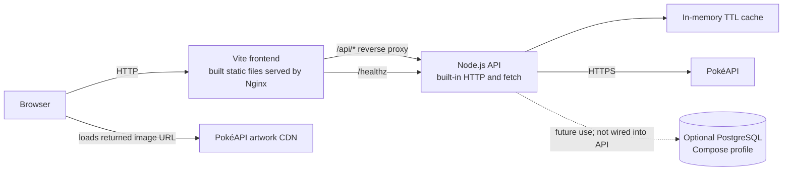
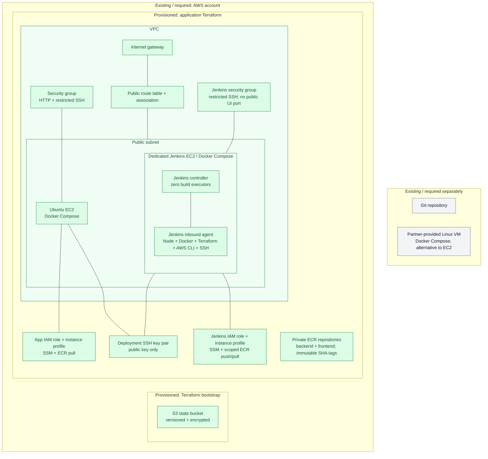
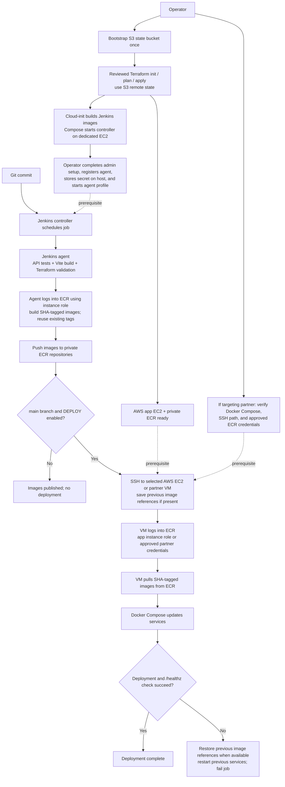

# Pokémon VM Demo

This demo pairs a Vite frontend with a Node.js API. Both services are packaged
as containers and run with Docker Compose on either an AWS EC2 instance created
by Terraform or a Linux VM provided by a partner.

## Application architecture



The UI searches by Pokémon name or Pokédex number and displays artwork, types,
base experience, stats, and an English description. The API normalizes PokéAPI
responses, limits upstream request time, rejects unsafe species URLs, and keeps
successful lookups in a bounded in-memory cache for 10 minutes. No DB is needed
for the current application. PostgreSQL is optional for future experimentation
and is not connected to the API.

## Infrastructure and delivery

### Infrastructure

This static view shows resource boundaries and associations, not execution
order. Green resources are provisioned by this repository's Terraform;
gray resources must already exist or be supplied separately. The state bucket
is provisioned once by the separate bootstrap configuration.



### Delivery

This dynamic view separates operator-reviewed infrastructure provisioning
from the Jenkins application pipeline. Terraform provisions the AWS app host,
ECR, and the Jenkins host together. A deployment can target the AWS app host
or a partner VM; the current configuration still creates the AWS app host
even when a partner VM is selected for deployment.



Terraform owns both AWS hosts, their network and IAM roles, and ECR. Jenkins
delivers application images but does not run Terraform apply. The controller
and agent share the dedicated Jenkins EC2 host, not the application host.
Initial Jenkins administration and agent registration remain manual so no
Jenkins admin password, agent secret, or SSH private key enters Terraform state.

## Repository layout

```text
app/
  backend/       Node.js API and built-in test suite
  frontend/      Vite application, source CSS/JS, and Nginx config
compose.yaml     Runtime services shared by local and VM deployments
compose.build.yaml
Jenkinsfile
jenkins/         Controller/agent Dockerfiles and Compose runtime
terraform/       App + Jenkins EC2, ECR, network/IAM, S3 state bootstrap
```

## Run locally

Prerequisites: Node.js 22.12+ and npm for development/tests, or Docker Engine
and Docker Compose v2 for the full containerized app.

Run the API tests:

```sh
cd app/backend
npm test
```

Run the Vite development server and the API in separate terminals:

```sh
cd app/backend
npm start
```

```sh
cd app/frontend
npm ci
npm run dev
```

The Vite dev server proxies `/api` and `/healthz` to the backend at
`http://backend:8080`; for local development outside Compose, use a proxy
override or run the stack below.

Build and launch the production-style Compose stack:

```sh
cp .env.example .env
# If port 80 is unavailable, set HTTP_PORT=8080 in .env.
docker compose -f compose.yaml -f compose.build.yaml up --build -d
```

Open `http://localhost` (or the port set in `.env`). Try `pikachu` or `25`.

```sh
curl http://localhost/healthz
curl http://localhost/api/pokemon/pikachu
docker compose -f compose.yaml -f compose.build.yaml logs -f
docker compose -f compose.yaml -f compose.build.yaml down
```

To start the optional, currently unused PostgreSQL service:

```sh
docker compose -f compose.yaml -f compose.build.yaml --profile database up --build -d
```

Change `POSTGRES_PASSWORD` in local `.env` first. The example value is only a
local placeholder; it must not be used outside a disposable demo. PostgreSQL
has no published host port and persists in a named Docker volume.

## Deploy to AWS with Terraform

Prerequisites: Terraform 1.10+, AWS credentials with permission to provision
the resources, and trusted IPv4 CIDRs for SSH access. The S3 state bucket is
bootstrapped once; its bootstrap state is local and must be stored securely.

Create a globally unique state bucket:

```sh
cd terraform/bootstrap
terraform init
terraform apply -var='bucket_name=your-unique-state-bucket'
cd ../..
```

The state bucket has versioning, server-side encryption, public-access
blocking, and a policy denying insecure transport. It is protected from
accidental deletion and remains after the application infrastructure is
destroyed.

Configure and apply the application, Jenkins, and ECR infrastructure:

```sh
cp terraform/backend.hcl.example terraform/backend.hcl
# Edit bucket and region in terraform/backend.hcl.
# Create an ignored terraform/demo.tfvars with:
# admin_cidrs = ["YOUR_ADMIN_CIDR/32"]
# ssh_public_key = "ssh-ed25519 AAAA..."
# jenkins_instance_type = "t3.medium"
# Use only the public key; it must match the Jenkins vm-deploy-key private key.
cd terraform
terraform init -backend-config=backend.hcl
terraform plan -var-file=demo.tfvars
terraform apply -var-file=demo.tfvars
terraform output app_url
terraform output instance_public_ip
terraform output instance_private_ip
terraform output image_registry
terraform output image_namespace
terraform output jenkins_public_ip
terraform output jenkins_tunnel_command
```

Both EC2 instances use Ubuntu 24.04, Docker/Compose v2, encrypted root volumes,
IMDSv2, and SSM instance roles. The Jenkins host defaults to `t3.medium` with a
40 GiB root disk; the app host defaults to `t3.micro` with 16 GiB. The Jenkins
metadata response hop limit is 2 so its containerized agent can obtain instance
credentials; the app host retains a hop limit of 1. HTTP port 80 defaults to public access; set
`app_cidr` to a narrower IPv4 range where appropriate. SSH is limited to
`admin_cidrs`; the app also accepts SSH from the Jenkins security group over
the private network. Use `instance_private_ip` as `DEPLOY_HOST`. Jenkins port
8080 binds only to host loopback, and agent connections use internal WebSocket
transport rather than a public inbound-agent port. Never open SSH to `0.0.0.0/0`.

The app role can only pull the two provisioned ECR repositories; the Jenkins
role can push and pull them. Neither role grants Terraform apply permissions.
ECR images are private, scanned on push, and use immutable tags. Rebuilding an
existing commit reuses its published image instead of overwriting it.

Destroy the demo when finished to stop ongoing compute and public IPv4 costs.
Delete ECR images explicitly first: nonempty repositories are intentionally
not force-deleted, so Terraform destroy will otherwise fail for those resources.

```sh
terraform destroy -var-file=demo.tfvars
```

This is a two-host public-subnet demo with no NAT Gateway, ALB, Route 53, or TLS
termination. It is not highly available or production ready. Add HTTPS,
monitoring, backups, and a private subnet design before exposing a real service.

## Deploy to a partner VM

The same Compose runtime and images can be used on a partner-provided VM.
Confirm that the VM:

- Runs supported Linux with Docker Engine and Compose v2.
- Has `/opt/pokemon-demo` writable by the deployment account and allows that
  account to run Docker.
- Is reachable from the Jenkins agent over a partner-approved SSH path.
  Provision its host key in the agent `known_hosts`; the pipeline enforces
  strict host-key checking.
- Can reach the image registry over HTTPS and make outbound HTTPS requests to
  `pokeapi.co`.
- Has port 80 available through approved ingress or a reverse proxy. This demo
  serves HTTP; TLS is not configured here.

For ECR deployment, install AWS CLI on the partner VM and provide a separately
approved AWS identity with ECR authorization-token and repository pull access.
The pipeline logs in on that VM before pulling; it does not forward the Jenkins
instance credentials or store registry secrets in the application Compose `.env`.
For non-ECR registries, VM-side private-registry authentication must likewise
be configured separately. Terraform does not configure partner-host credentials
or its network path.

## Jenkins pipeline setup

Terraform cloud-init copies the files from `jenkins/` into `/opt/jenkins` on
the dedicated host, builds both images, and starts the controller. The image
installs Pipeline, Git, Credentials Binding, and SSH Agent plugins and sets
controller executors to zero. The agent image includes Node.js 22, npm, Docker
CLI/Compose, Terraform 1.10.5, AWS CLI, and SSH tools.

1. SSH to `jenkins_public_ip`. Wait for provisioning and inspect failures with
  `sudo cloud-init status --wait` and `/var/log/cloud-init-output.log`.
2. On your workstation, run the `jenkins_tunnel_command` output and open
  `http://localhost:8080`. On the host, retrieve the initial unlock password:

  ```sh
  sudo docker compose -f /opt/jenkins/compose.yaml exec controller \
    cat /var/jenkins_home/secrets/initialAdminPassword
  ```

3. Complete the setup wizard and create an admin account. Keep authentication
  enabled. Under Manage Jenkins, create a permanent node named
  `docker-terraform-ssh`, with that same label, one executor, remote root
  `/home/jenkins/agent`, and the inbound-agent launch method. Use this node only
  for jobs matching its label. Its connection will use WebSocket transport.
4. On the host, use `sudoedit /opt/jenkins/.env` to set
  `JENKINS_AGENT_SECRET` to the node's secret shown in Jenkins. Do not paste
  it into Terraform, Git, or shell history. The file is root-owned with mode
  `0600`. Start the agent:

  ```sh
  sudo docker compose -f /opt/jenkins/compose.yaml --profile agent up -d
  ```

5. Store the deployment private key in Jenkins as SSH credential
  `vm-deploy-key`; its public half must match `ssh_public_key` for the AWS
  app host. Add the verified SSH host-key entry for the exact `DEPLOY_HOST`
  address to `/opt/jenkins/known_hosts` using `sudoedit`. Verify its fingerprint
  through a trusted channel; do not blindly trust a key collected over the
  deployment network. The file is mounted read-only into the agent.

For ECR, no `container-registry` password credential or static AWS key is
needed: the agent uses the Jenkins EC2 role. For another registry, select
`REGISTRY_AUTH=credentials` and create the `container-registry` username/password
credential with push access.

Configure a Multibranch Pipeline. The pipeline runs Node API tests, builds the
Vite app, validates Terraform, builds images tagged with the Git commit SHA,
and pushes them. Set `REGISTRY_AUTH=ecr`, `IMAGE_REGISTRY` to Terraform's
`image_registry` output, `IMAGE_NAMESPACE` to `image_namespace`, and `AWS_REGION`
to the provisioned region. The first multibranch run exposes these parameters;
rerun with the correct values before publishing. To deploy, enable `DEPLOY`, set `DEPLOY_HOST` and
`DEPLOY_USER`, and run the `main` branch. The deployment checks `/healthz` and
restores the previous image references if rollout or health checks fail.

Terraform apply remains an operator-reviewed step outside the app pipeline.
The Jenkins agent must have an approved network path to partner VMs; do not
open public SSH broadly for convenience.

## Security and limitations

- Never commit `.env`, Terraform state, backend config, credentials, or private
  keys.
- Keep Jenkins controller off the public application host and restrict SSH to
  trusted administrator/agent CIDRs.
- The agent runs as root with the Docker socket mounted, giving trusted builds
  root-equivalent access to the Jenkins host. Controller/agent containers share
  that host and its IAM identity; they are not a security isolation boundary.
  Do not run untrusted pull requests on this deployment agent.
- Jenkins home and agent workspaces use local Docker volumes. Back up Jenkins
  home and host-local secrets before instance replacement or destruction;
  changing bootstrap files replaces the Jenkins instance and loses these volumes.
- Jenkins UI access requires an SSH tunnel; public HTTPS ingress is not configured.
- Use SSM Session Manager where possible for AWS administration.
- HTTP is unencrypted; do not send credentials or sensitive data through it.
- One VM is a single point of failure and may be unavailable during updates.
- The optional database is not used by the app; its example password is not
  production safe.
