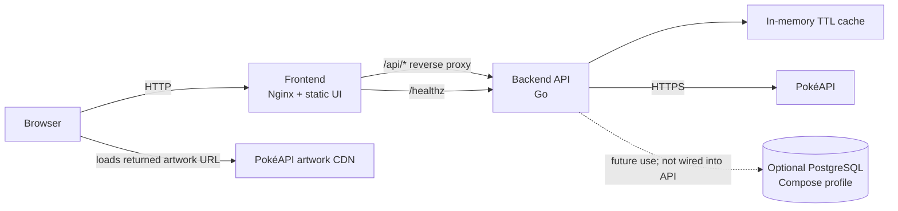
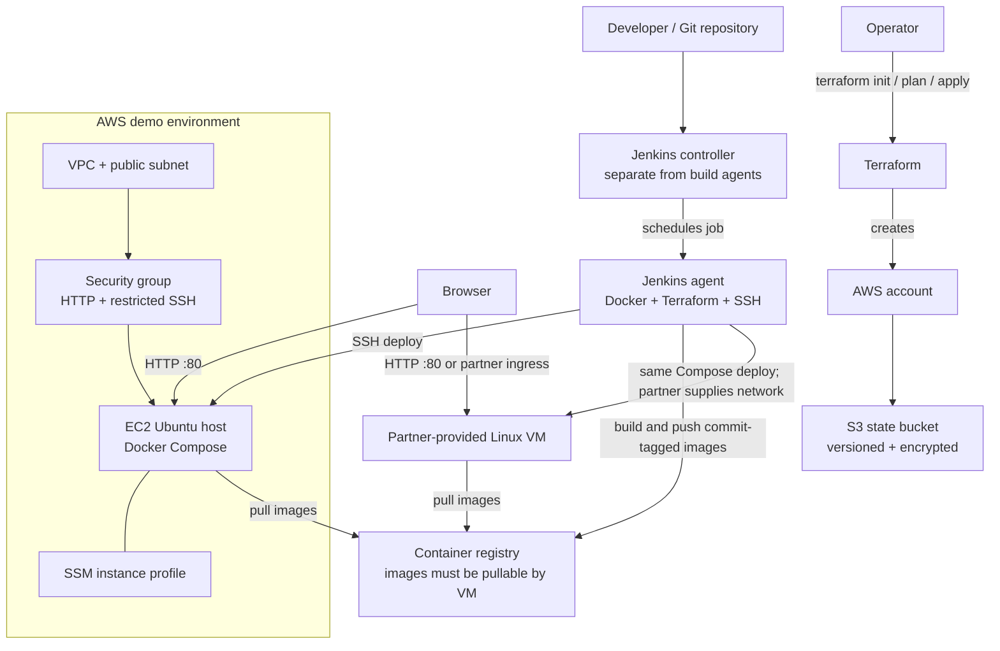

# Jenny

A small Jenkins and Terraform demo: a Pokémon lookup app runs as two Docker Compose
services and can be deployed either to an AWS EC2 instance created by Terraform or
to a Linux VM provided by a partner.

## Architecture

### Application



The frontend searches by Pokémon name or Pokédex number and shows artwork, types,
base stats, and an English description. The backend calls PokéAPI with request
timeouts, normalizes the response, and caches successful lookups in memory for
10 minutes. No database is needed for the current demo. PostgreSQL is included
as an optional Compose profile for later experiments and is not connected to the
application.

### Infrastructure and delivery



Jenkins runs application delivery; Terraform provisions the AWS VM and network.
The supplied pipeline validates Terraform but intentionally does not run
`terraform apply` automatically. For a partner VM, skip the AWS Terraform step
and configure Jenkins to reach the supplied VM.

## Repository layout

```text
app/
  backend/       Go API and unit tests
  frontend/      Static Pokédex UI and Nginx reverse proxy
compose.yaml     Runtime services shared by local and VM deployments
compose.build.yaml
Jenkinsfile
terraform/       AWS host/network and remote state bootstrap
```

## Run locally

Prerequisites: Docker Engine and Docker Compose v2.

```sh
cp .env.example .env
# If port 80 is unavailable or requires elevated privileges, set HTTP_PORT=8080 in .env.
docker compose -f compose.yaml -f compose.build.yaml up --build -d
```

Open `http://localhost` (or the port set in `.env`). Try `pikachu` or `25`.

```sh
curl http://localhost/healthz
curl http://localhost/api/pokemon/pikachu
docker compose -f compose.yaml -f compose.build.yaml logs -f
docker compose -f compose.yaml -f compose.build.yaml down
```

Run backend unit tests with `cd app/backend && go test ./...`.

To start the optional, currently unused PostgreSQL service locally:

```sh
docker compose -f compose.yaml -f compose.build.yaml --profile database up --build -d
```

Change `POSTGRES_PASSWORD` in the local `.env` first. The committed example value
is only a local placeholder and must not be used outside a disposable demo.
PostgreSQL has no published host port and persists data in a named Docker volume.

## Deploy to AWS with Terraform

Prerequisites: Terraform 1.10+, AWS credentials with permission to provision the
listed resources, and trusted IPv4 CIDRs for SSH access. The state-bucket bootstrap
is a one-time step; its own state remains local, so store that bootstrap state
securely.

1. Create a globally unique, dedicated bucket for Terraform state:

   ```sh
   cd terraform/bootstrap
   terraform init
   terraform apply -var='bucket_name=your-unique-state-bucket'
   cd ../..
   ```

   The bucket has versioning, server-side encryption, public-access blocking,
   and a policy that denies insecure transport. Keep its name available for the
   app configuration. It is protected from accidental deletion and remains when
   the application infrastructure is destroyed.

2. Configure and apply the app infrastructure:

   ```sh
   cp terraform/backend.hcl.example terraform/backend.hcl
   # Edit bucket and region in terraform/backend.hcl.
   # Create a local, ignored terraform/demo.tfvars:
   # admin_cidrs = ["YOUR_ADMIN_CIDR/32", "YOUR_JENKINS_AGENT_EGRESS_CIDR/32"]
   # ssh_public_key = "ssh-ed25519 AAAA..."
   # The key must match the vm-deploy-key private key stored in Jenkins.
   # Never put a private key in Terraform.
   cd terraform
   terraform init -backend-config=backend.hcl
   terraform plan -var-file=demo.tfvars
   terraform apply -var-file=demo.tfvars
   terraform output app_url
   terraform output instance_public_ip
   ```

   The EC2 instance gets Ubuntu 24.04, Docker/Compose v2, an encrypted root
   volume, IMDSv2, and an SSM instance role. HTTP port 80 defaults to public
   access; set `app_cidr` to a narrower IPv4 range when appropriate. SSH is
   limited to required `admin_cidrs`. Include only trusted admin/agent ranges;
   do not use `0.0.0.0/0` for SSH.

3. Destroy the demo when finished to stop ongoing compute and public IPv4 costs:

   ```sh
   terraform destroy -var-file=demo.tfvars
   ```

The AWS example deliberately has one public EC2 instance, no NAT Gateway, ALB,
Route 53, or TLS termination. It is a low-complexity HTTP demo, not a highly
available or production-ready design. Add HTTPS (for example, a managed
certificate and ingress proxy), monitoring, backups, and a private subnet design
before exposing a real service.

## Deploy to a partner VM

Use the same Compose runtime and image tags. Confirm that the partner VM:

- Runs a supported Linux distribution with Docker Engine and Compose v2.
- Has `/opt/pokemon-demo` writable by the deployment account and permits that
  account to run Docker.
- Allows the Jenkins agent to connect over SSH through the partner-approved
  network path. Pin the VM host key in the agent's `known_hosts`; the pipeline
  requires strict host-key checking.
- Can reach the selected container registry over HTTPS and can make outbound
  HTTPS requests to `pokeapi.co`.
- Makes port 80 available through the partner's approved ingress or reverse
  proxy. The demo itself serves HTTP; TLS is not configured by this repository.

The Jenkins deploy job assumes the published images can be pulled anonymously by
the VM. Use public images for this demo; for a private registry, add a separately
approved VM-side registry authentication mechanism rather than copying registry
secrets into the Compose `.env` file.

## Jenkins setup

The Jenkins controller and agent are prerequisites managed separately; this
repository does not provision the Jenkins service itself. Run the controller
separately from an agent and do not execute builds on the controller. Configure
a persistent deployment-capable agent with the label
`docker-terraform-ssh` and install Go, Docker/Compose, Terraform 1.10+, and SSH
client tools on it. The controller and agent should be managed separately from
the application VM.

Create these Jenkins credentials:

- `container-registry`: username/password credential with permission to push
  the selected registry namespace.
- `vm-deploy-key`: SSH private key for the deployment account. Install the
  matching public key on the target VM and provision the target host key in
  the agent's `known_hosts`.

Install the Pipeline, Credentials Binding, SSH Agent, and Git plugins, and
enable Pipeline Multibranch support. The sample pipeline requires a Docker
daemon on its agent.

Configure a Multibranch Pipeline for this repository. Set `IMAGE_REGISTRY` and
`IMAGE_NAMESPACE` to a registry/repository where the VM can anonymously pull
images. The pipeline runs backend tests and Terraform validation, builds images
tagged with the Git commit SHA, and pushes them. To deploy, choose `DEPLOY`,
provide a reachable `DEPLOY_HOST` and `DEPLOY_USER`, and run the `main` branch.
Deployment copies only the Compose runtime file and image references, checks
`/healthz`, and restores the prior image references if rollout or health checks
fail.

The Jenkins agent must be able to reach the VM directly. For partner networks,
place the agent in an approved network or use the partner's approved private
connectivity; do not make SSH broadly accessible just to enable deployment.
Terraform deployment is an operator-reviewed step and is not run by this
application pipeline.

## Security and demo limitations

- Never commit `.env`, Terraform state, backend configuration, or credentials.
- Restrict SSH to a trusted CIDR and keep the Jenkins controller off the public
  application host.
- The EC2 instance's SSM role supports Session Manager administration; use it
  where possible instead of expanding SSH access.
- HTTP is unencrypted in this demo. Do not use real credentials or sensitive
  data through it.
- A single VM is a single point of failure and a maintenance window may occur
  during host or Docker updates.
- The optional database profile is not used by the application, and its
  local-only sample password is not production-safe.

## Skills

Terraform:

```sh
npx skills add hashicorp/agent-skills --agent github-copilot -s
```

Jenkins:

```sh
npx skills add https://github.com/bagelhole/devops-security-agent-skills --skill jenkins --agent github-copilot -y
```

## Demo

See [demo.md](demo.md) for the Pokémon app architecture, local run instructions,
Node.js/Vite details, AWS and partner-VM deployment, Jenkins setup, and Mermaid diagrams.
